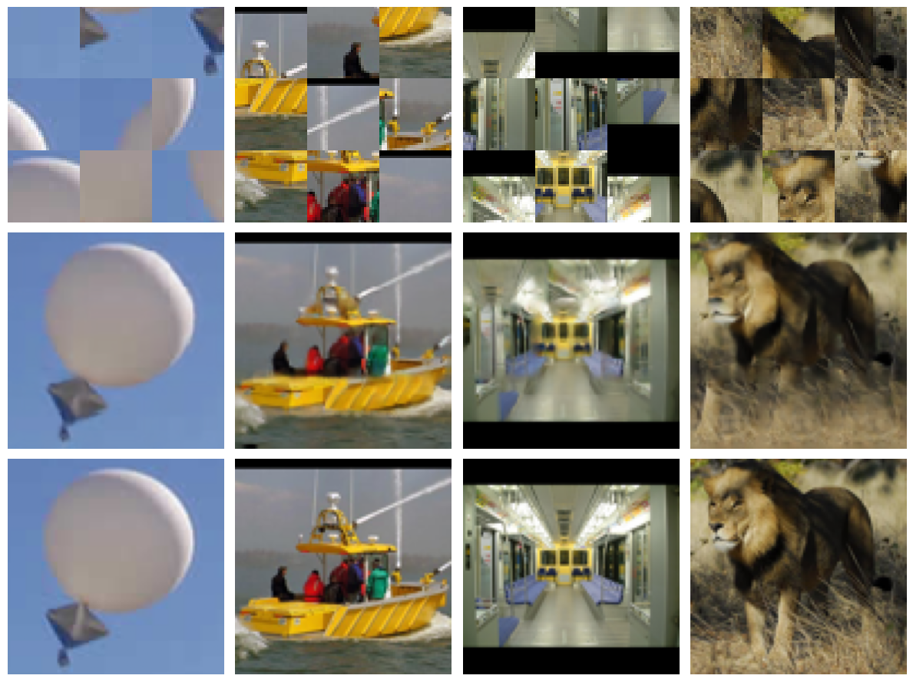
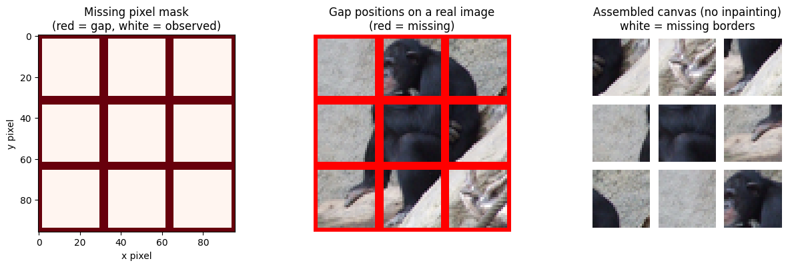
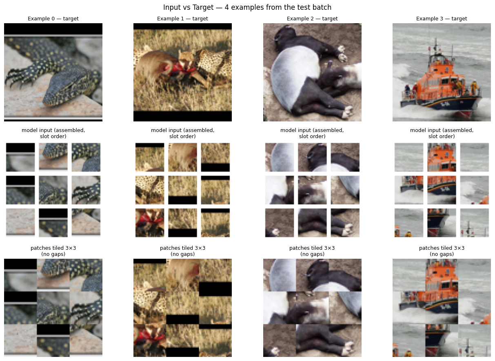

# Jigsaw puzzle reconstruction with a transformer

The task is to reconstruct a complete 96×96 RGB image from 9 scrambled patches of size 28×28. The problem is two-fold:

1. **A combinatorial part: decide the arrangement**, i.e. *where each patch goes* (there are 9! = 362,880 possible orderings). This is a relational problem: each patch only makes sense next to the others, which is exactly what attention is very good at.
2. **A generative part: fill in the missing pixels.** The patches have an eroded border, so even with the right arrangement part of the image is missing and has to be generated.

This was my final project for the Deep Learning course of the MSc in Artificial Intelligence at the University of Bologna (2026). The problem statement, the data loader and the mean-patch baseline were provided by the course; the rest (from "Proposed solution" onwards in the notebook) is my solution.

*Top row: the 9 shuffled patches as the model receives them. Middle: the model's reconstruction. Bottom: the original image.*

## The data

We use the Stanford STL-10 dataset, containing 100K color images at resolution (96,96), covering 10 classes: airplane, bird, car, cat, deer, dog, horse, monkey, ship, truck.

### Missing pixels

Each 28×28 patch sits inside a 32×32 cell. This means we have a **2px eroded border** on each side. When reassembled, those borders form a regular "tic-tac-toe" of missing pixels — **~23% of the image area** that the model must inpaint. We will have to fill in those missing pixels!

### Starting image VS Patches VS Eroded Patches

The model receives `X` of shape `(batch, 9, 28, 28, 3)`: the 9 eroded patches, shuffled. Top row: the original image. Middle: the patches as the model receives them, placed in slot order. Bottom: the same patches tiled without gaps.

## The model

The architecture we implement is inspired by the seminal paper *Attention is all you need* and is based on a simple encoder-decoder transformer, sandwiched between a CNN encoder and a CNN upsampler.

The problem can be decomposed in two sub-problems:

1. **Decide the arrangement**  *where each patch goes*. This is a relational problem: each patch only makes sense next to the others, which is exactly what attention is very good at. The transformer looks at the 9 patches and produces a **soft 9×9 permutation** $P$.
2. **Assemble from real detail.** We then build the image from the patches' **own feature maps**.

More in detail, we can describe the model's architecture as follows:

1. **CNN ENCODING** receives in input $(B,9,28,28,3)$ where $B$ is the batch size, 9 is the number of patches, 28x28 is the resolution of a single patch, and 3 is the number of channels. This block applies a reshape and three convolution layers. It outputs a tensor **$m$** of shape $(B * 9, 28,28,64)$. These are the **feature maps**.
2. We "adjust" the feature map $m$ before feeding it to the encoder transformer block. In particular, we apply GlobalAveragePooling, a reshape and a dense layer with dimension $d = 256$. We obtain as output a "tokenised version" of $m$ of shape $(B, 9, 256)$.
3. **ENCODER TRANSFORMER BLOCK**. Is a loop repeating three times, each consisting of MultiHeadAttention + Residual + Dense(256). The output is a tensor **$x$** of shape (B, 9, 256).
4. **DECODER TRANSFORMER BLOCK**. Is a loop repeating three times, each consisting of:
   - MultiHeadSelfAttention of $q$ with itself, where $q = Embeddings(9, 256)$ is the positions query. It is a learned vector, and we can think of it as encoding the *things to look for at each of the 9 positions in the 3x3 grid*.
   - MultiHeadCrossAttention(q,x);
   - Dense(256)

   Output: Updated q, tensor of shape $(B,9,256)$.
5. **RECONSTRUCTION & UPSAMPLING**. This last stage is the concatenation of:
   - Building the soft-permutation matrix $P$ from $q$ and $x$ using einsum;
   - Apply $P$ to the feature maps $m$ to move patches in the predicted grid cells. As output we obtain a tensor of shape $(B, 84,84,64)$. In this way we are ready for the final upsampling block.
   - Chain of upsampling convolutions to reconstruct the pixel values from the now-ordered features. This outputs a tensor of shape $(B, 96,96,3)$, which is our final output.

The model seemed to converge steadily but very slowly. Therefore I used a very long training routine to allow the model to plateau, with a variable learning rate and patience, and I ran two training sessions of 50 epochs each, overnight.

## Results and conclusion

The metric is the Mean Absolute Error (MAE) over the 10,000 test images, compared with the baseline given by the course, which for every pixel takes the mean of the corresponding pixels in the 9 patches and repeats that pattern across the whole image.

| | MAE | std |
|---|---|---|
| Mean-patch baseline (provided by the course) | 0.182 | 0.001 |
| **My model** | **0.051** | 0.001 |

- The MAE on the test set is around $0.0512$, with standard deviation $\sim 0.0006$;
- The total number of trainable parameters of this model is $3,683,971$ (≈ 3.7M), comfortably under the 6M limit.
- Convergence was slow and steady, requiring long training runs. This made time a real design bottleneck;
- As potential improvements, I would next try to implement a sharper inpainting using a different more aggressive loss. It was interesting to note how adding more attention heads worsened model performance. Probably the model started to overfit by paying attention to non-meaningful relations between patches features, resulting in more frequent mismatches.

The rules of the project were strict: the solution had to rely entirely on neural networks, with no pretrained models, fewer than 6 million parameters, in Keras and runnable on Google Colab. On the other hand, we were allowed, and encouraged, to use AI tools for writing the code, which made it possible to experiment with many different architectures before settling on this one. The grade depended deterministically on the final test MAE, and this solution earned **28/30**.

## Running it

The easiest way is Google Colab: [open the notebook in Colab](https://colab.research.google.com/github/luca-de-rosa/jigsaw-transformer/blob/main/jigsaw_puzzle.ipynb) and run all cells. The notebook:

- downloads the [STL-10](http://ai.stanford.edu/~acoates/stl10/) dataset (unlabelled split, 100,000 images, about 2.6 GB; this takes a few minutes);
- downloads my trained weights (45 MB) from Google Drive with `gdown`, so no training is needed;
- evaluates the model on the test images and shows some reconstructions.

To retrain from scratch, set `do_training = True` (a GPU is strongly recommended). To run it locally instead: `pip install -r requirements.txt`, then open the notebook.

## License

My code is released under the [MIT](LICENSE) license. The problem statement and the starter code (data loader, baseline) belong to the course.
